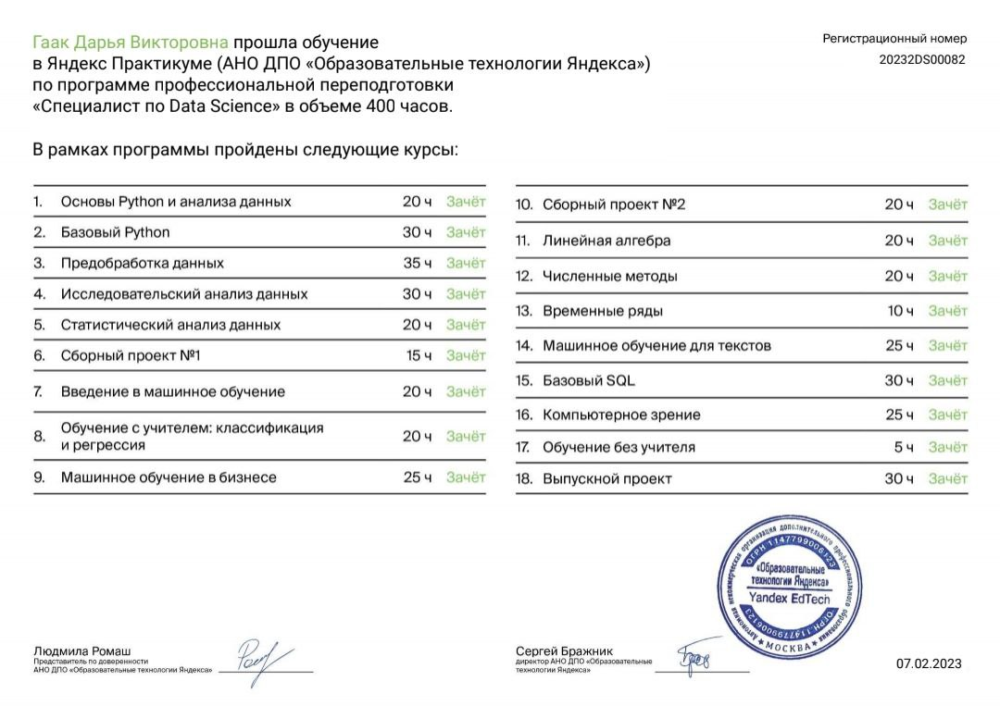

# Сертификаты

## Яндекс Практикум

Диплом о профессиональной переподготовке по программе «Специалист по Data Science».

## Practicum by Yandex

## [SQL для анализа данных с Глебом Михайловым](https://stepik.org/cert/1957942)

Сертификат с отличием, 17 февраля 2023.

## [Акселерационная программа «Искусственный интеллект ТУСУР»](https://sbi.tusur.ru/aksel_ii_tusur)

Удостоверение о повышении квалификации, 160 часов.

## Управление, основанное на данных

Удостоверение ТУСУР по программе «Chief Data Officer в органах власти», 108 часов.

